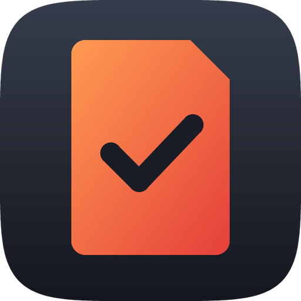

# Notch

A macOS menu bar app that imports SD cards straight into organised project folders.

Insert a card. Notch reads it, works out the shoot dates and which cameras were used, and asks
which project each shoot date belongs to: a new project or one of your last three. It then copies
photos and videos into the right year, month, project and camera folders and verifies every copy.

**Also on Windows:** a Windows 10/11 version with the same features lives in [`windows/`](windows/).
It shares the folder layout and the project files, so a projects folder on an exFAT SSD works on
both.

## Download

| | |
| --- | --- |
| **Mac** (macOS 13 or later, Apple silicon or Intel) | [Notch.dmg](https://github.com/thudelja/Notch/releases/latest/download/Notch.dmg) |
| **Windows** (Windows 10 1809 or later, or 11) | [Notch-Setup.exe](https://github.com/thudelja/Notch/releases/latest/download/Notch-Setup.exe) |

All versions are on the [Releases](https://github.com/thudelja/Notch/releases) page. How to
install: [Mac](#install-on-a-mac) · [Windows](windows/README.md#install).

## The folder structure

Everything goes into one **projects folder** (default `~/Pictures/Projects`, changeable in
Settings, can be an external drive):

```
Projects/
└── 2026/
    ├── Photo/
    │   └── 11 November/
    │       └── 02.11.2026 Ana Wedding/
    │           ├── R5/            ← IMG_0001.CR3, IMG_0001.JPG …
    │           └── R6/
    └── Video/
        └── 11 November/
            └── 02.11.2026 Ana Wedding/
                ├── Media/
                │   ├── R5/        ← C0001.MP4, C0001M01.XML …
                │   └── R6/
                ├── Project/       ← for your editing project
                ├── Assets/
                └── Export/
```

- **Year, month and date** come from the **shoot date** stored in each file (EXIF for photos, clip
  metadata for video), falling back to the file's date. Importing a week later still files
  everything under the day it was shot.
- **Photo or Video** is decided by file type. A card with both is split between the two branches,
  under the same project name.
- **A project folder** is named after its first shoot day. Adding a later day to an existing
  project puts the files in that same folder.
- **Camera folders** are always created, even when only one camera was used, so files never move
  later and editing projects never lose their media links.
- **Original file names** are kept. RAW and JPEG stay side by side. If two different files share
  a name, the newer one is saved as `IMG_0001 (1).JPG`; nothing is ever overwritten.
- **Sidecar files** (Sony/Canon clip `.XML`, GoPro `.THM`, DJI `.LRF`/`.SRT`, `.XMP`) are copied
  next to the file they belong to. **Audio** (`.WAV` etc.) goes to the video project's
  `Media/<device>/`. Camera system and database files are skipped.

## Importing a card

1. **Insert the card.** Notch reads it in the background. Nothing is copied yet.
2. **A notification appears**, and the menu bar icon shows a count of cards waiting.
3. **Click the Notch icon** (an SD card with a check) in the menu bar. The Import panel lists every shoot date on the card with its
   photo, video and audio counts. For each date, choose:
   - **New project** and type its name
   - **Same as** another new project on this card (for a multi-day shoot)
   - one of your **last three projects**
   - **Skip for now**

   By default, every date goes into one new project. Below the dates, check the **camera folder
   names**. They are read from the files (`Canon EOS R5` → `R5`, `ILCE-7M4` → `A7 IV`) and you
   can change them. Your names are remembered for next time.
4. **Click Import.** Files are copied, checked against the originals, and the card can be ejected
   automatically.

Insert the same card again later and only the **new** files are offered. If there's nothing new,
you just get a notification. Choose **Not Now** to close the panel; you can start again with
**Import** next to the card.

### Camera detection

- **Photos:** always detected, from EXIF.
- **Sony video:** detected from the clip XML.
- **Other video:** detected from file metadata where the camera writes it. If it doesn't, the
  video is assumed to come from the camera that shot the card's photos.
- **Audio, and anything else without camera info:** shown as "No camera info". The name you type
  is remembered for that card, for example "Zoom H5" for a recorder card.

## Moving a year to an SSD

When a year is finished, or your Mac runs low on space, move the whole year to an external drive.
Open **Settings › Move a year to another drive**, pick the year and click **Move to Drive…**, then
choose a folder on the drive (for example `SSD/Projects`). The year is moved into it with exactly
the same structure:

```
Mac:  ~/Pictures/Projects/2026/…   →   SSD:  /Volumes/SSD/Projects/2026/…
```

- **Safe, file by file:** each file is copied, read back from the SSD and checked (SHA-256), then
  deleted from the Mac. Anything that can't be copied or checked stays on the Mac and is listed
  in the log.
- **Interruptions are fine:** if you stop the move, pull the drive or quit, every file is either
  moved or still on the Mac. Moving the year again finishes the job. Files already on the SSD
  are recognised by comparing their bytes.
- **Everything moves:** photos, videos, audio, editing projects, empty Project/Assets/Export
  folders, file dates and Finder tags.
- **Afterwards:** moved projects stay in your recent list and open from the SSD. Adding a card
  to one of them imports straight onto the SSD. If the SSD isn't connected, the Import panel
  tells you. New projects are still created on the Mac; move them the same way later, and they
  merge into the year folder on the SSD.
- Editing projects that link to moved media (Premiere Pro, DaVinci Resolve, …) may ask you to
  relink once.

Imports wait while a year is being moved. Progress appears in the menu bar panel.

## Install on a Mac

Requires macOS 13 Ventura or later, on Apple silicon or Intel.

### Option A: download it

1. Download [Notch.dmg](https://github.com/thudelja/Notch/releases/latest/download/Notch.dmg)
   and open it.
2. Drag **Notch** onto the **Applications** folder in the window that opens.
3. Open Notch from Applications. macOS blocks it the first time, because the app isn't notarised
   by Apple (that needs a paid Apple developer account). Click **Done**, open
   **System Settings › Privacy & Security**, scroll down to *"Notch was blocked…"* and click
   **Open Anyway**. This is needed only once.

The Notch icon (an SD card with a check) appears in the menu bar. To update, download the new
version and replace the app in Applications; your settings and projects stay.

### Option B: build it yourself

Requires Xcode, or just the Command Line Tools: `xcode-select --install`.

```bash
./scripts/build-app.sh --install
```

This compiles the app, puts `Notch.app` in `/Applications`, and launches it. To build without
installing, omit `--install`; the app is written to `build/Notch.app`. Apps you build yourself
aren't blocked by macOS.

The app was called SD Backup before. If `SD Backup.app` is installed, `--install` replaces it, and
your settings, projects and import records carry over. (With Option A, delete `SD Backup.app` from
Applications yourself.)

### First launch

macOS will ask for two permissions. Allow both:

1. **Notifications**, so you know when a card is ready to import and when it's done.
2. **Access to files on a removable volume**, which appears the first time a card is inserted.
   If you dismissed the prompt, enable it in
   **System Settings › Privacy & Security › Files and Folders › Notch › Removable Volumes**.

When the app runs from `/Applications`, it registers itself to open at login the first time it
starts. You can change this in Settings.

> Notch is signed ad hoc rather than with an Apple Developer ID. macOS ties privacy permissions to
> the signature, so after an update you may be asked for card access again.

## The menu bar panel

The panel is styled like Control Center:

- **Toggles**: Auto Import (read and ask as soon as a card is inserted), Verify (SHA-256 check of
  every copy), Auto Eject.
- **Projects** opens the projects folder. **Settings** opens all options.
- **Import**: the shoot-date and camera choices described above.
- **Status**: reading progress, or import progress with size, file count, time left and a cancel
  button.
- **Cards** lists connected cards, when each was last imported, and **Import** / **Eject** buttons.
- **Recent** shows the last imports. Click one to open its project folder.

Ejecting a card in Finder while it is being read or imported stops that work so the card can be
ejected. If macOS says the disk is still in use, eject it again.

## Settings

- **Projects folder.**
- **Ask for a project as soon as a card is inserted.**
- **Which cards count:** SD and camera cards, or any removable drive. External hard drives and
  SSDs are never included.
- **Verify** and **eject**.
- **Open at login** and **notifications**.
- **Move a year to another drive** (see above).
- **Forget Imported Files** offers every file on every card again. **Forget Camera Names**
  resets the folder names you've given cameras.

Each projects folder contains a hidden `.sdbackup` folder that identifies it and lists its
projects, without any absolute paths. That's how moved projects are found again when the SSD
mounts under a different name, and how the Windows version opens the same folders. Don't
delete it.

The rest of the app's memory is local to this Mac: `~/Library/Application Support/SD Backup` holds
where each projects folder was last seen, a copy of the project list and the import records. The
log is at `~/Library/Logs/SD Backup/backups.log`. (These folders keep the app's earlier name, so
nothing is lost when updating.)

## Development

```bash
swift build          # compile
swift test           # run the core tests (requires full Xcode)
swift run SDBackup   # run without an app bundle (notifications and login item are disabled)
```

To work in Xcode, run `open Package.swift`.

| Path | Purpose |
| --- | --- |
| `Sources/SDBackupCore/CardAnalyzer.swift` | Reads a card: shoot days, cameras, what's new. |
| `Sources/SDBackupCore/MediaClassifier.swift` | Photo / video / audio / sidecar detection, and pairing sidecars with their media. |
| `Sources/SDBackupCore/MediaMetadata.swift` | EXIF (ImageIO), video metadata (AVFoundation), Sony clip XML. |
| `Sources/SDBackupCore/CameraNames.swift` | `Canon EOS R5` → `R5`, `ILCE-7M4` → `A7 IV`, … |
| `Sources/SDBackupCore/ProjectLayout.swift` | Folder naming, the copy plan, and the per-card import record. |
| `Sources/SDBackupCore/BackupEngine.swift` | Verified, non-destructive, crash-safe copying. |
| `Sources/SDBackupCore/YearMigrator.swift` | Moves a year folder to another drive, deleting each original after verification. |
| `Sources/SDBackupCore/ProjectLibrary.swift` | The portable `.sdbackup/library.json` file, and finding projects folders again on any drive. |
| `Sources/SDBackup/AppModel.swift` | The read → choose project → import flow. |
| `Sources/SDBackup/ImportDraft.swift` | Your per-date project choices and camera names. |
| `Sources/SDBackup/LibraryStore.swift` | Saved projects, camera names and import records. |
| `Sources/SDBackup/VolumeInspector.swift` | Decides whether a mounted volume is an SD/camera card. |
| `Sources/SDBackup/Views/` | Control Center–style panel and the Settings window (SwiftUI). |
| `Sources/SDBackup/MenuBarIcon.swift` | The menu bar icon, drawn in code. |
| `scripts/build-app.sh` | Builds, bundles and ad-hoc signs the `.app`; `--universal --dmg` makes the download. |
| `branding/make_icons.py` | Draws the logo and writes the Mac and Windows icon files (`python3 branding/make_icons.py`). |

**Windows:** the Windows version is in [`windows/`](windows/). [PORTING.md](PORTING.md) is its
specification: the rules, the data formats, the Windows equivalents of each macOS API, and the tests.

### Releasing a version

Tag the commit and push the tag:

```bash
git tag v1.0.0
```

```bash
git push origin v1.0.0
```

CI then builds `Notch.dmg` (Apple silicon and Intel) and `Notch-Setup.exe` (x64 and ARM64), with
the tag as the version number, and publishes them on a GitHub release. The download links above
always point to the latest release.

The core module (`SDBackupCore`) has no UI and is covered by `Tests/SDBackupCoreTests`, including
an end-to-end import of a mixed Canon/Sony/recorder card into the project structure.
