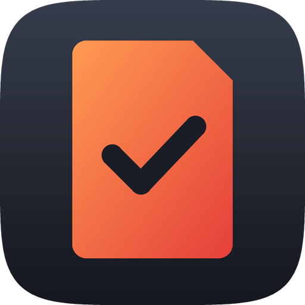

# Notch

Aplikacija za menijsko vrstico v macOS, ki kartice SD uvozi naravnost v urejene mape projektov.

Vstavite kartico. Notch jo prebere, ugotovi datume snemanja in uporabljene fotoaparate ter vpraša,
kateremu projektu pripada vsak datum snemanja: novemu projektu, dnevu večdnevnega snemanja ali enemu
od zadnjih dveh projektov. Nato fotografije in videoposnetke kopira v prave mape let, mesecev,
projektov in fotoaparatov, vsake na svoje mesto, in preveri vsako kopijo.

Notch govori **slovensko** in **angleško** (*in English*: [README.md](README.md)). Sledi jeziku
računalnika, v nastavitvah pa ga lahko izberete sami.

**Tudi za Windows:** različica za Windows 10/11 z enakimi funkcijami je v mapi [`windows/`](windows/README.sl.md).
Uporablja enako strukturo map in iste datoteke projektov, zato mapa s projekti na SSD-ju exFAT deluje
na obeh.

## Prenos

| | |
| --- | --- |
| **Mac** (macOS 13 ali novejši, Apple silicon ali Intel) | [Notch.dmg](https://github.com/thudelja/Notch/releases/latest/download/Notch.dmg) |
| **Windows** (Windows 10 1809 ali novejši ali Windows 11) | [Notch-Setup.exe](https://github.com/thudelja/Notch/releases/latest/download/Notch-Setup.exe) |

Vse različice so na strani [Releases](https://github.com/thudelja/Notch/releases). Namestitev:
[Mac](#namestitev-na-macu) · [Windows](windows/README.sl.md#namestitev).

## Struktura map

Vse gre v eno **mapo s projekti** (privzeto `~/Pictures/Projects`; spremenite jo v nastavitvah, lahko
je tudi na zunanjem pogonu). Na Macu v slovenščini dobi nova, prazna mapa s projekti slovenska imena
map:

```
Projects/
└── 2026/
    ├── Foto/
    │   └── 11 november/
    │       └── 02.11.2026 Poroka Ana/
    │           ├── R5/            ← IMG_0001.CR3, IMG_0001.JPG …
    │           └── R6/
    └── Video/
        └── 11 november/
            └── 02.11.2026 Poroka Ana/
                ├── Posnetki/
                │   ├── R5/        ← C0001.MP4, C0001M01.XML …
                │   └── R6/
                ├── Projekt/       ← za vaš projekt montaže
                ├── Viri/
                └── Izvoz/
```

V angleščini so imena `Photo`, `Video`, `11 November` ter `Media`, `Project`, `Assets` in `Export`.
Mapa s projekti ohrani imena, s katerimi je začela, ne glede na to, v katerem jeziku je Notch pozneje.

- **Leto, mesec in datum** so iz **datuma snemanja**, zapisanega v vsaki datoteki (EXIF pri
  fotografijah, metapodatki posnetka pri videu), sicer iz datuma datoteke. Tudi če uvozite teden
  pozneje, gre vse pod dan, ko je bilo posneto.
- **Foto ali Video** se določi po vrsti datoteke. Kartica z obojim se razdeli na obe veji, pod istim
  imenom projekta. Fotografije in videoposnetki imajo vsak svoj **cilj**: mapo s projekti in
  strukturo (glejte spodaj). Ko gredo oboji v isto mapo, jih mapi `Foto` in `Video` ločita; če imajo
  videoposnetki svojo mapo, sta ti mapi izpuščeni.
- **Mapa projekta** dobi ime po prvem dnevu snemanja. Ko obstoječemu projektu dodate poznejši dan,
  gredo datoteke v isto mapo.
- **Mape fotoaparatov** nastanejo vedno, tudi če je bil uporabljen le en fotoaparat, zato se datoteke
  pozneje nikoli ne premikajo in projekti montaže ne izgubijo povezav do posnetkov.
- **Izvirna imena datotek** ostanejo. RAW in JPEG ostaneta drug ob drugem. Če imata dve različni
  datoteki isto ime, se novejša shrani kot `IMG_0001 (1).JPG`; nič se nikoli ne prepiše.
- **Spremne datoteke** (`.XML` pri Sony/Canon, `.THM` pri GoPro, `.LRF`/`.SRT` pri DJI, `.XMP`) se
  kopirajo poleg datoteke, ki ji pripadajo. **Zvok** (`.WAV` ipd.) gre v video projekt, v
  `Posnetki/<naprava>/`. Sistemske datoteke in zbirke podatkov fotoaparatov se preskočijo.

### Lastna struktura

**Nastavitve › Struktura map …** spremeni, kako so urejeni novi projekti, z zavihkoma
**Fotografije** in **Videoposnetki**: fotografije in videoposnetki imajo vsak svojo strukturo. Pod
mapo leta, ki je vedno prva, ravni sestavite iz gradnikov: mapa **Foto** ali **Video** (preimenujte
ali izpustite jo), **mesec** (`11 november`, `11` ali `november`, slovenska ali angleška imena),
**mape s stalnim imenom**, na primer `Stranke`, **mapa projekta** (`02.11.2026`, `2026-11-02` ali
`20261102`, pred imenom ali za njim) in neobvezni par **Neurejeno / Izvoženo**. Mape fotoaparatov
lahko tudi izklopite, na zavihku Videoposnetki pa izberete mape, ki nastanejo v vsakem video
projektu. Urejevalnik sproti prikazuje primere poti.

Pri paru Neurejeno / Izvoženo gredo uvozi v prvo mapo, poleg pa nastane prazna mapa Izvoženo z enako
potjo, za vaše izvoze. Na primer fotografije z `2026 › Foto › Neurejeno/Izvoženo › mesec` in
videoposnetki s privzeto strukturo:

```
2026/Foto/Neurejeno/11 november/02.11.2026 Poroka Ana/R5/IMG_0001.CR3
2026/Foto/Izvoženo/11 november/02.11.2026 Poroka Ana/       ← prazna, za izvoze
2026/Video/11 november/02.11.2026 Poroka Ana/Posnetki/R5/C0001.MP4
```

Struktura se shrani v mapo s projekti, zato različici za Mac in Windows na skupnem pogonu naredita
enake mape. **Obstoječi projekti se nikoli ne premaknejo:** vsak projekt ohrani strukturo, s katero
je nastal, in ko mu dodate dan, gredo datoteke še vedno v njegovo mapo.

## Uvoz kartice

1. **Vstavite kartico.** Notch jo prebere v ozadju. Ničesar še ne kopira.
2. **Prikaže se obvestilo**, ikona v menijski vrstici pa pokaže, koliko kartic čaka.
3. **Kliknite ikono Notch** (kartica SD s kljukico) v menijski vrstici. Podokno za uvoz navede vsak
   datum snemanja na kartici s številom fotografij, videoposnetkov in zvočnih posnetkov. Za vsak
   datum izberite:
   - **Nov projekt** in vnesite njegovo ime. Pod imenom **Fotografije → Projects** in
     **Videoposnetki → Projects** pokažeta, kam gredo njegove datoteke. **Spremeni …** izbere drugo
     mapo za fotografije ali za videoposnetke (drugi ostanejo na svojem mestu): Notch naredi mapo
     projekta (`02.11.2026 Ana`) v mapi, ki jo izberete. Če izberete mapo projekta, ki ga Notch že
     pozna, se datum doda temu projektu; tako dosežete starejše projekte.
   - **Novo večdnevno snemanje …** za snemanje čez več dni ali kartic, na primer koledar: vnesite ime
     snemanja (`AMD Koledar 2026`) in projekt dneva (`Ana`). Glejte
     [Večdnevna snemanja](#večdnevna-snemanja).
   - **Nov v „AMD Koledar 2026“**: naslednji dan odprtega večdnevnega snemanja.
   - **Enako kot** drug nov projekt na tej kartici
   - enega od **zadnjih dveh projektov**
   - **Zaenkrat preskoči**

   Privzeto gredo vsi datumi v en nov projekt. Pod datumi preverite **imena map fotoaparatov**.
   Prebrana so iz datotek (`Canon EOS R5` → `R5`, `ILCE-7M4` → `A7 IV`) in jih lahko spremenite.
   Vaša imena si Notch zapomni za naslednjič.
4. **Kliknite Uvozi.** Datoteke se kopirajo in preverijo z izvirniki, kartica pa se lahko samodejno
   izvrže.

Ko isto kartico pozneje vstavite znova, so ponujene le **nove** datoteke. Če ni nič novega, dobite le
obvestilo. Z **Ne zdaj** zaprete podokno; uvoz lahko znova začnete z **Uvozi** ob kartici.

### Prepoznavanje fotoaparatov

- **Fotografije:** vedno prepoznane, iz podatkov EXIF.
- **Video Sony:** prepoznan iz datoteke XML posnetka.
- **Drug video:** prepoznan iz metapodatkov datoteke, če jih fotoaparat zapiše. Sicer Notch privzame,
  da je video s fotoaparata, ki je posnel fotografije na kartici.
- **Zvok in vse drugo brez podatkov o fotoaparatu:** prikazano kot „Ni podatkov o fotoaparatu“. Ime,
  ki ga vnesete, si Notch zapomni za to kartico, na primer „Zoom H5“ za kartico snemalnika.

## Večdnevna snemanja

Večdnevno snemanje (koledar, festival, serija) ima vse svoje dni v eni mapi. Njegova mapa zavzame
mesto meseca v vaših strukturah, vsak dan pa je projekt v njej:

```
2026/Foto/AMD Koledar 2026/02.11.2026 Ana/R5/…
2026/Foto/AMD Koledar 2026/09.11.2026 Maja/R5/…
2026/Video/AMD Koledar 2026/Posnetki/02.11.2026 Ana/R5/…
2026/Video/AMD Koledar 2026/Posnetki/09.11.2026 Maja/R5/…
2026/Video/AMD Koledar 2026/Projekt/   Viri/   Izvoz/      ← enkrat za celotno snemanje
```

Videoposnetki so en projekt montaže za celotno snemanje: posnetki vsakega dne gredo v svojo mapo v
`Posnetki`. Pri paru Neurejeno / Izvoženo dobijo fotografije kot običajno oboje
(`2026/Foto/Neurejeno/AMD Koledar 2026/02.11.2026 Ana/…`).

Začnete ga v podoknu za uvoz z **Novo večdnevno snemanje …**. Odslej je ponujeno nad nedavnimi
projekti kot **Nov v „AMD Koledar 2026“**. Ko je snemanje končano, 1,5 sekunde **držite** gumb
**Držite za zaključek** (med držanjem se napolni krog; kratka animacija pokaže, da ga je treba
držati, ne klikniti), v podoknu ali v **Nastavitve › Večdnevna snemanja**, kjer lahko snemanje tudi
znova odprete. Snemanje, ki ga 100 dni ne uporabite, samo izgine iz podokna.

## Premik leta na SSD

Ko je leto končano ali na Macu zmanjkuje prostora, premaknite celotno leto na zunanji pogon. Odprite
**Nastavitve › Premik leta na drug pogon**, izberite leto, kliknite **Premakni na pogon …** in izberite
mapo na pogonu (na primer `SSD/Projects`). Leto se premakne vanjo z natanko enako strukturo:

```
Mac:  ~/Pictures/Projects/2026/…   →   SSD:  /Volumes/SSD/Projects/2026/…
```

- **Varno, datoteko za datoteko:** vsaka datoteka se kopira, prebere nazaj s SSD-ja in preveri
  (SHA-256), nato pa izbriše z Maca. Kar se ne da kopirati ali preveriti, ostane na Macu in je
  navedeno v dnevniku.
- **Prekinitve niso težava:** če premik ustavite, izvlečete pogon ali zaprete Notch, je vsaka datoteka
  bodisi premaknjena bodisi še na Macu. Ko leto znova premaknete, se delo dokonča. Datoteke, ki so
  že na SSD-ju, se prepoznajo s primerjavo njihove vsebine.
- **Premakne se vse:** fotografije, videoposnetki, zvok, projekti montaže, prazne mape
  Projekt/Viri/Izvoz, datumi datotek in oznake v Finderju.
- **Potem:** premaknjeni projekti ostanejo na seznamu nedavnih in se odpirajo s SSD-ja. Če kartico
  dodate enemu od njih, se uvozi naravnost na SSD. Če SSD ni priključen, vas na to opozori podokno za
  uvoz. Novi projekti še vedno nastajajo na Macu; pozneje jih premaknete enako in se združijo z mapo
  leta na SSD-ju.
- Projekti montaže, ki se sklicujejo na premaknjene posnetke (Premiere Pro, DaVinci Resolve …), vas
  bodo morda enkrat prosili, da jih znova povežete.

Med premikom leta uvozi čakajo. Napredek je prikazan v podoknu v menijski vrstici.

## Namestitev na Macu

Potrebujete macOS 13 Ventura ali novejši, na Apple silicon ali Intel.

### Možnost A: prenos

1. Prenesite [Notch.dmg](https://github.com/thudelja/Notch/releases/latest/download/Notch.dmg)
   in ga odprite.
2. V oknu, ki se odpre, povlecite **Notch** na mapo **Applications** (Aplikacije).
3. Odprite Notch iz Aplikacij. macOS ga prvič blokira, ker aplikacije ni overil Apple (za to je
   potreben plačljiv račun razvijalca Apple). Kliknite **Končano**, odprite
   **Sistemske nastavitve › Zasebnost in varnost** (System Settings › Privacy & Security), se
   pomaknite do *„Notch je bil blokiran …“* in kliknite **Vseeno odpri** (Open Anyway). To je
   potrebno le enkrat.

Ikona Notch (kartica SD s kljukico) se prikaže v menijski vrstici. Za posodobitev prenesite novo
različico in zamenjajte aplikacijo v Aplikacijah; vaše nastavitve in projekti ostanejo.

### Možnost B: lastna gradnja

Potrebujete Xcode ali le orodja ukazne vrstice: `xcode-select --install`.

```bash
./scripts/build-app.sh --install
```

To prevede aplikacijo, postavi `Notch.app` v `/Applications` in jo zažene. Za gradnjo brez
namestitve izpustite `--install`; aplikacija se zapiše v `build/Notch.app`. Aplikacij, ki jih zgradite
sami, macOS ne blokira.

Aplikacija se je prej imenovala SD Backup. Če je nameščena `SD Backup.app`, jo `--install` zamenja,
vaše nastavitve, projekti in zapisi uvozov pa se prenesejo. (Pri možnosti A `SD Backup.app` iz
Aplikacij izbrišite sami.)

### Prvi zagon

macOS vpraša za dve dovoljenji. Dovolite obe:

1. **Obvestila**, da veste, kdaj je kartica pripravljena na uvoz in kdaj je uvoz končan.
2. **Dostop do datotek na izmenljivem nosilcu**, ki se prikaže, ko prvič vstavite kartico. Če ste
   poziv zaprli, ga omogočite v **Sistemske nastavitve › Zasebnost in varnost › Datoteke in mape ›
   Notch › Izmenljivi nosilci** (Files and Folders › Removable Volumes).

Ko aplikacija teče iz `/Applications`, se ob prvem zagonu sama nastavi, da se odpre ob prijavi. To
lahko spremenite v nastavitvah.

**Posodobitev z 1.0 ali 1.1:** Notch 1.2 ima svoj identifikator aplikacije (prejšnji je bil iz prvih
različic SD Backup, zato so obvestila kazala prazno ikono). Nastavitve, imena fotoaparatov in nedavni
uvozi se prenesejo samodejno, macOS pa še enkrat vpraša za obvestila in dostop do kartic. Če
**Sistemske nastavitve › Splošno › Elementi prijave** (Login Items) navajajo Notch dvakrat, odstranite
izklopljeni vnos.

> Notch je podpisan ad hoc, ne z Apple Developer ID. macOS veže dovoljenja za zasebnost na podpis,
> zato vas lahko po posodobitvi znova vpraša za dostop do kartic.

## Podokno v menijski vrstici

Podokno je oblikovano kot Nadzorno središče (Control Center):

- **Stikala:** Samodejni uvoz (preberi in vprašaj takoj, ko je kartica vstavljena), Preveri
  (preverjanje vsake kopije s SHA-256), Samodejno izvrzi.
- **Projekti** odpre mapo s projekti. **Nastavitve** odpre vse možnosti.
- **Uvoz:** izbira datumov snemanja in fotoaparatov, opisana zgoraj.
- **Stanje:** napredek branja ali napredek uvoza z velikostjo, številom datotek, preostalim časom in
  gumbom za preklic.
- **Kartice:** priključene kartice, kdaj je bila vsaka nazadnje uvožena, ter gumba **Uvozi** in
  **Izvrzi**.
- **Nedavno:** zadnji uvozi. Kliknite enega, da odprete mapo projekta.

Če kartico izvržete v Finderju, medtem ko se bere ali uvaža, se to delo ustavi, da se kartica lahko
izvrže. Če macOS sporoči, da je disk še v uporabi, ga izvrzite znova.

## Nastavitve

- **Mapa s projekti** za fotografije in po želji **ločena mapa za videoposnetke** (na primer na
  SSD-ju). Videoposnetki novih projektov gredo potem tja, s svojo strukturo map; obstoječi projekti
  ostanejo, kjer so. Tu sta tudi **strukturi map** za fotografije in videoposnetke (glejte zgoraj).
- **Večdnevna snemanja:** zaključite jih ali znova odprite (glejte zgoraj).
- **Vprašaj za projekt takoj, ko je kartica vstavljena.**
- **Katere kartice štejejo:** kartice SD in kartice fotoaparatov ali vsak izmenljivi pogon. Zunanji
  trdi diski in SSD-ji niso nikoli vključeni.
- **Preverjanje** in **izvrženje**.
- **Odpri nove fotografije v Lightroom Classic ali Lightroom** po uvozu (Nastavitve › Po uvozu).
  Aplikacija odpre svoje okno za uvoz s fotografijami tega uvoza; videoposnetki se ne pošljejo. V
  Lightroom Classic izberite **Add**, da fotografije ostanejo, kamor jih je dal Notch. Lightroom jih
  kopira v svojo knjižnico in sinhronizira z Adobovim oblakom.
- **Jezik:** kot Mac, angleščina ali slovenščina. Notch preklopi ob naslednjem zagonu; **Znova zaženi
  zdaj** to naredi namesto vas. Nastavite ga lahko tudi v **Sistemske nastavitve › Splošno › Jezik in
  regija › Aplikacije**.
- **Odpri ob prijavi** in **obvestila**.
- **Premik leta na drug pogon** (glejte zgoraj). Z ločeno mapo za videoposnetke izberete, ali leto
  premaknete iz mape za fotografije ali iz mape za videoposnetke.
- **Različica** je prikazana na dnu.
- **Pozabi uvožene datoteke** znova ponudi vse datoteke na vseh karticah. **Pozabi imena
  fotoaparatov** ponastavi imena map, ki ste jih dali fotoaparatom.

Vsaka mapa s projekti vsebuje skrito mapo `.sdbackup`, ki jo označuje in navaja njene projekte, brez
absolutnih poti. Tako se premaknjeni projekti najdejo znova, ko se SSD priklopi pod drugim imenom, in
tako različica za Windows odpre iste mape. Ne brišite je.

Preostali spomin aplikacije je lokalen na tem Macu: `~/Library/Application Support/SD Backup` hrani,
kje je bila vsaka mapa s projekti nazadnje, kopijo seznama projektov in zapise uvozov. Dnevnik je v
`~/Library/Logs/SD Backup/backups.log` (v angleščini). (Te mape ohranijo prejšnje ime aplikacije, zato se pri
posodobitvi nič ne izgubi.)

## Razvoj

Razvojna dokumentacija (gradnja, preizkusi, zgradba kode, izdaje) je v angleščini, v
[README.md](README.md#development) in [PORTING.md](PORTING.md).

Slovenska besedila aplikacije so v `Resources/sl.lproj/Localizable.strings` (Mac) in
`windows/src/SDBackup.Core/Strings/sl.json` (Windows), po angleškem besedilu. Preizkusi in CI
preverijo, da ima vsako besedilo prevod.
