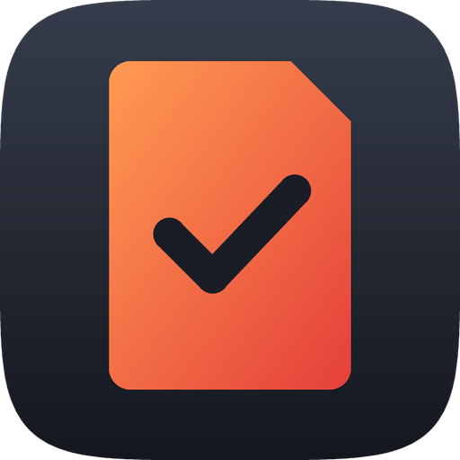

# Notch za Windows

Različica Notch za Windows 10 in 11. Dela natanko to, kar različica za Mac (glejte
[glavni README](../README.sl.md)), in uporablja enako strukturo map in iste datoteke projektov, zato mapa
s projekti na SSD-ju exFAT deluje na obeh. V slovenščini ali angleščini (*in English*:
[README.md](README.md)).

- Živi v **območju za obvestila** (spodaj desno, ob Wi-Fi in uri). Kliknite ikono Notch (oranžna kartica
  SD s kljukico), da odprete podokno v slogu hitrih nastavitev sistema Windows 11. Z desnim klikom
  odprete meni.
- Ko vstavite kartico, prebere datume snemanja in fotoaparate, pokaže obvestilo, podokno pa vpraša,
  kateremu projektu pripada vsak datum snemanja (novemu projektu, dnevu večdnevnega snemanja ali enemu
  od zadnjih dveh projektov).
- Fotografije kopira v `Projects\2026\Foto\11 november\02.11.2026 Ime\<Fotoaparat>\`, videoposnetke pa
  v `Projects\2026\Video\11 november\02.11.2026 Ime\Posnetki\<Fotoaparat>\` (ter `Projekt`, `Viri`,
  `Izvoz`) ali vsake v svojo mapo in s svojo strukturo, vsako datoteko preveri s SHA-256, nikoli ne
  prepisuje in ob ponovno vstavljeni kartici ponudi le nove datoteke. (V angleščini so imena map
  `Photo`, `11 November`, `Media`, `Project`, `Assets` in `Export`.)
- **Celotno leto premakne** na zunanji pogon iz nastavitev in vsako datoteko z računalnika izbriše šele,
  ko je njena kopija preverjena.
- Sledi svetlemu/temnemu načinu, barvi poudarka in jeziku prikaza sistema Windows (slovenščina ali
  angleščina).

## Zahteve

- Windows 11 ali Windows 10 različica 1809 ali novejša
- računalniki x64 ali ARM64 (Snapdragon)

## Namestitev

### Možnost A: prenos namestitvenega programa

1. Prenesite [Notch-Setup.exe](https://github.com/thudelja/Notch/releases/latest/download/Notch-Setup.exe)
   (vse različice so na strani [Releases](https://github.com/thudelja/Notch/releases)).
2. Zaženite ga. Aplikacija ni podpisana s potrdilom (to je plačljivo), zato lahko Windows sporoči
   *„Windows je zaščitil vaš računalnik“* (Windows protected your PC): kliknite **Več informacij**
   (More info), nato **Vseeno zaženi** (Run anyway).
3. Kliknite **Namesti**, nato **Dokončaj**. Notch se zažene.

Namestitveni program je v slovenščini ali angleščini, kot je nastavljen Windows. Namesti le za vašega
uporabnika, brez skrbniških pravic, v `%LOCALAPPDATA%\Programs\Notch`, z vnosom v meniju Start. Isti
namestitveni program deluje na običajnih (x64) in ARM (Snapdragon) računalnikih. Za posodobitev zaženite
namestitveni program nove različice; vaše nastavitve in projekti ostanejo.

### Možnost B: lastna gradnja

1. Namestite .NET 10 SDK. V PowerShellu:

   ```powershell
   winget install Microsoft.DotNet.SDK.10
   ```

2. Prenesite repozitorij (**Code → Download ZIP** na GitHubu) in ga razširite.
3. Odprite PowerShell v mapi `windows` in zaženite:

   ```powershell
   powershell -ExecutionPolicy Bypass -File .\build.ps1 -Install
   ```

To zažene preizkuse, zgradi `Notch.exe`, ga namesti v `%LOCALAPPDATA%\Programs\Notch`, doda **Notch** v
meni Start, ga nastavi za zagon ob zagonu sistema Windows in ga zažene. Aplikacije, ki jih zgradite sami,
ne sprožijo SmartScreena.

### Prvi zagon

- **Poiščite ikono.** Windows 11 nove ikone v območju za obvestila skrije za puščico **^**. Ikono kartice
  SD povlecite v opravilno vrstico ali jo vklopite v **Nastavitve › Prilagajanje › Opravilna vrstica ›
  Druge ikone v sistemski vrstici** (Settings › Personalization › Taskbar › Other system tray icons).
- **Izklopite poziv sistema Windows (neobvezno).** Windows ob vstavljeni kartici pokaže svoj poziv za
  samodejno predvajanje. Izklopite ga tako, da v **Nastavitve › Bluetooth in naprave › Samodejno
  predvajanje** nastavite **Pomnilniška kartica** na **Ne izvedi nobenega dejanja** (Memory card › Take
  no action).
- **Mapa s projekti.** Privzeta je `Pictures\Projects`. Spremenite jo v **Nastavitvah**, kjer lahko
  izberete tudi ločeno mapo za videoposnetke (na primer na SSD-ju). Videoposnetki novih projektov gredo
  potem tja, s svojo strukturo map. Različica je prikazana na dnu nastavitev.
- **Jezik.** Notch sledi jeziku prikaza sistema Windows. Če želite sami izbrati slovenščino ali
  angleščino, uporabite **Nastavitve › Splošno › Jezik** in nato **Znova zaženi zdaj**.

## Uporaba

Podokno od zgoraj navzdol prikazuje:

- **Ploščice hitrih nastavitev:** Samodejni uvoz, Preveri in Samodejno izvrzi. Pod njimi so gumbi, ki
  odprejo mapo s projekti, nastavitve in dnevnik.
- **Uvoz:** vrstica za vsak datum snemanja z izbiro projekta (Nov projekt, Novo večdnevno snemanje …,
  Nov v „…“ za vsako odprto večdnevno snemanje, Enako kot drug nov projekt, zadnja dva projekta ali
  Zaenkrat preskoči) ter imena map fotoaparatov. Nov projekt pokaže **Fotografije → …** in
  **Videoposnetki → …**: **Spremeni …** izbere drugo mapo za njegove fotografije ali videoposnetke,
  Notch pa v njej naredi mapo projekta z datumom. Če izberete mapo projekta, ki ga Notch že pozna, se
  datum doda temu projektu. Dan v večdnevnem snemanju ima gumb **Držite za zaključek**: ko je
  snemanje končano, ga držite 1,5 sekunde.
- **Napredek:** branje kartice, uvoz ali premik leta, vsak z gumbom za preklic.
- **Kartice:** priključene kartice, kdaj je bila vsaka nazadnje uvožena, ter gumba **Uvozi** in **Izvrzi**.
- **Nedavno:** zadnji uvozi. Kliknite enega, da odprete njegovo mapo.

**Nastavitve › Struktura map …** spremeni, kako so novi projekti urejeni pod mapo leta, z zavihkoma
**Fotografije** in **Videoposnetki** (vsak ima svojo strukturo): mapa Foto ali Video (preimenovana ali
izpuščena), mesec (številka, ime ali oboje, slovenska ali angleška imena), mape s stalnim imenom, oblika
datuma in vrstni red v mapi projekta, neobvezni par **Neurejeno / Izvoženo** (uvozi gredo v prvo mapo;
druga, prazna, z enako potjo nastane za izvoze), mape fotoaparatov vklopljene ali izklopljene ter mape v
vsakem video projektu. Strukturi se shranita v mapo s projekti, zato pogon, ki si ga deli z Macom, naredi
enake mape. Obstoječi projekti ohranijo svoje mape. Nova, prazna mapa s projekti dobi slovenska imena map,
ko je Notch v slovenščini.

**Večdnevna snemanja** (koledar, festival) imajo vse dni v eni mapi, ki zavzame mesto meseca:
`2026\Foto\AMD Koledar 2026\02.11.2026 Ana\…`, videoposnetki pa en projekt montaže za celotno snemanje,
`2026\Video\AMD Koledar 2026\Posnetki\02.11.2026 Ana\…`. **Nastavitve › Večdnevna snemanja** jih
navajajo, da jih zaključite ali znova odprete; glejte [glavni README](../README.sl.md#večdnevna-snemanja).

V **Nastavitve › Po uvozu** lahko Notch nove fotografije vsakega uvoza odpre v **Lightroom Classic** ali
**Lightroom**. Aplikacija jih odpre v svojem oknu za uvoz (videoposnetki se ne pošljejo). V Lightroom
Classic izberite **Add**, da fotografije ostanejo, kamor jih je dal Notch; Lightroom jih kopira v svojo
knjižnico in sinhronizira z Adobovim oblakom.

### Skupni pogon z Macom

SSD formatirajte kot **exFAT**. Windows ne bere APFS, macOS pa ne piše na NTFS. Vsaka mapa s projekti
vsebuje skrito mapo `.sdbackup` s svojimi projekti in oznako. Ko priključite pogon, Notch poišče mape s
projekti v njegovem korenu in eno raven niže ter njihove projekte doda na seznam nedavnih. To deluje
tudi, če pogon dobi drugo črko kot zadnjič.

### Kje je kaj

| Kaj | Kje |
| --- | --- |
| Aplikacija | `%LOCALAPPDATA%\Programs\Notch\Notch.exe` |
| Nastavitve, shranjeni projekti, zapisi uvozov | `%APPDATA%\Notch` |
| Dnevnik (v angleščini) | `%LOCALAPPDATA%\Notch\Logs\backups.log` |

### Odstranitev

Odprite **Nastavitve › Aplikacije › Nameščene aplikacije** (Settings › Apps › Installed apps), poiščite
**Notch** in izberite **Odstrani namestitev**. Če ste ga namestili z `build.ps1`, zaženite:

```powershell
powershell -ExecutionPolicy Bypass -File .\build.ps1 -Uninstall
```

V obeh primerih se odstranijo aplikacija, njena bližnjica in vnos za zagon ob zagonu sistema Windows.
Vaših projektov se nič ne dotakne. Nastavitve in zapisi uvozov ostanejo v `%APPDATA%\Notch`; če želite
odstraniti tudi njih, izbrišite to mapo.

## Razlike od različice za Mac

- **Izvrženja iz Raziskovalca med uvozom** Windows ne dovoli, ker je kartica v uporabi. Najprej
  prekličite uvoz v podoknu, nato kartico izvrzite.
- **Preverjanje:** kopije se zapisujejo neposredno na pogon in nato preberejo nazaj za preverjanje
  SHA-256. V sistemu Windows se lahko branje postreže iz predpomnilnika datotek.
- **Prepoznavanje kartic** uporablja serijsko številko nosilca, ki jo pokaže Windows. Ob ponovnem
  formatiranju kartice se spremeni, tako kot na Macu.
- **Skupni pogoni:** mape s projekti na priključenih pogonih se najdejo samodejno (razdelek zgoraj). Na
  Macu se projekti pogona prikažejo, ko nanj premaknete leto ali ga izberete kot mapo s projekti.

## Razvoj

Razvojna dokumentacija (gradnja, preizkusi, samopreizkus, prevodi) je v angleščini, v
[README.md](README.md#development) in [PORTING.md](../PORTING.md).
